<div align="center">

# PrivaOps
### Enterprise Privacy & Data Lifecycle Operations Platform

**Know your data. Govern the process. Prove the work.**

A multi-tenant privacy operations workspace for data inventory, processing transparency, privacy request coordination, and operational audit history.

[](https://github.com/matiur25580/PrivaOps-Enterprise-Privacy-Data-Lifecycle-Platform/actions/workflows/ci.yml)


[Product overview](#-product-overview) · [Dashboard showcase](#-dashboard-showcase) · [Architecture](#-architecture) · [Run locally](#-run-locally) · [API](#-api-reference) · [Deployment](#-manual-deployment)

</div>

---

## 📌 Project overview

PrivaOps brings practical privacy operations into one organization-scoped workspace. It helps teams answer four operational questions:

1. **What personal data do we hold?** Maintain a searchable inventory of data assets, classifications, owners, data subjects, and systems.
2. **Why and how is it processed?** Document processing purposes, operational legal-basis categories, linked assets, systems, and retention context.
3. **What happens when a person makes a request?** Intake, assign, verify, track, and resolve privacy requests through an explicit lifecycle.
4. **Can we explain what changed?** Review organization-scoped audit metadata with actor, action, resource, changed-field names, and timestamps.

> **Project positioning:** PrivaOps is an engineering portfolio project for privacy operations. It is not a legal compliance product, certification, or substitute for qualified legal/privacy advice.

## ✨ Product capabilities

### Implemented capabilities

| Module | What is implemented |
| --- | --- |
| Identity & sessions | Organization registration, login, Argon2id password hashing, short-lived JWT access tokens, opaque refresh tokens hashed at rest, HttpOnly refresh cookie, refresh rotation, logout, encrypted TOTP MFA enrollment and login challenge |
| Multi-tenancy | Organization membership, server-derived tenant scope, active membership checks, explicit owner/admin/member/viewer permissions |
| Data inventory | Create, search, filter, paginate, update, and soft-archive data assets; record classification, system, owner team, data categories, and data subjects |
| Processing register | Document processing purpose, operational legal-basis category, data categories, data subjects, systems, linked assets, and retention period |
| Privacy request workflow | Request intake, own-request visibility, authorized organization queue, assignment, due date, identity-verification state, controlled status transitions, withdrawal, resolution details, and event history |
| Audit activity | Tenant-scoped inventory audit events, actor metadata, changed-field names, timestamps, and owner/admin read permission |
| Web workspace | Responsive overview, inventory and processing views, request queue and detail timeline, search/filter controls, CSV exports, session restore and one-time refresh retry |
| API operations | Versioned API, environment validation, health liveness/readiness endpoints, bounded JSON body size, Helmet, restricted credentialed CORS, authentication rate limiting |
| Engineering quality | TypeScript monorepo, ESLint, Vitest, GitHub Actions CI for install, lint, typecheck, tests, and build |

### Not implemented yet — explicitly out of scope for this milestone

The following are roadmap items, not existing features:

- Email verification and secure password recovery.
- Recovery codes, email verification, and account recovery.
- Organization invitations and self-service member lifecycle management.
- Consent lifecycle management and consent evidence.
- Automated retention/deletion execution and scheduled background jobs.
- Incident response, vendor risk management, and DPIA workflows.
- Evidence attachments, notifications, and configurable workflow automation.
- Independent audit-log tamper resistance and external evidence retention.
- Full integration and end-to-end test coverage, production monitoring, and backup/restore drills.

A dashboard indicator or a stored legal-basis label must never be interpreted as proof of compliance.

---

## 🖥️ Dashboard showcase

The following 12 visuals are **illustrative product UI previews** created for the portfolio README. They use fictional organization and operator data; they are not screenshots of a live production tenant. Each preview is intentionally presented in a **single vertical column** so reviewers can inspect the product story from top to bottom.

### 01 · Privacy operations command center
A high-level view of inventory, processing activity, open requests, and recent operational signals.

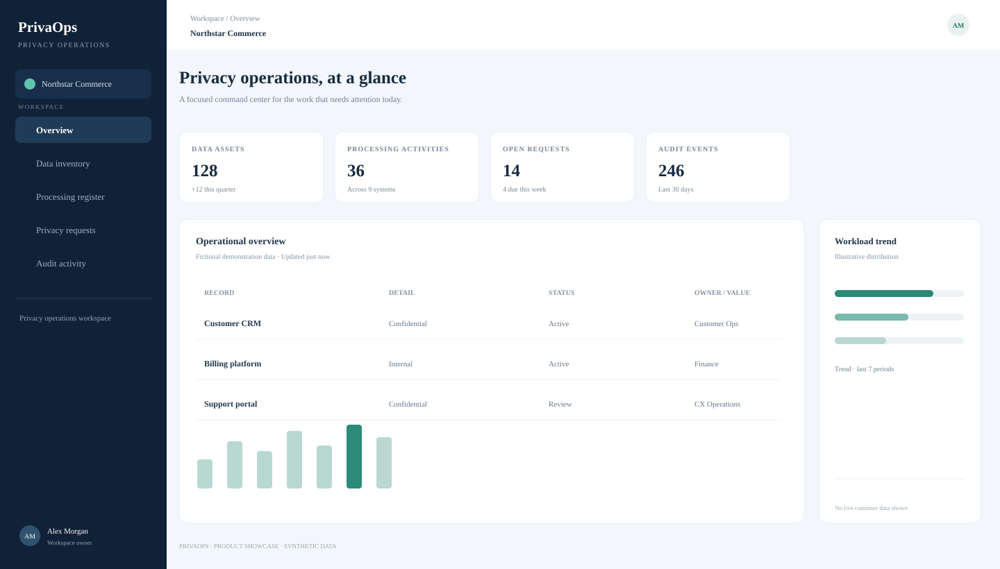

### 02 · Operational privacy posture
A conceptual overview of coverage, upcoming work, and areas that may need operator review.

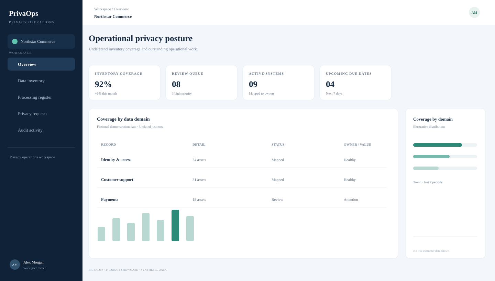

### 03 · Data asset inventory
A searchable register for discovering data assets, understanding classification, and seeing accountable owner teams.

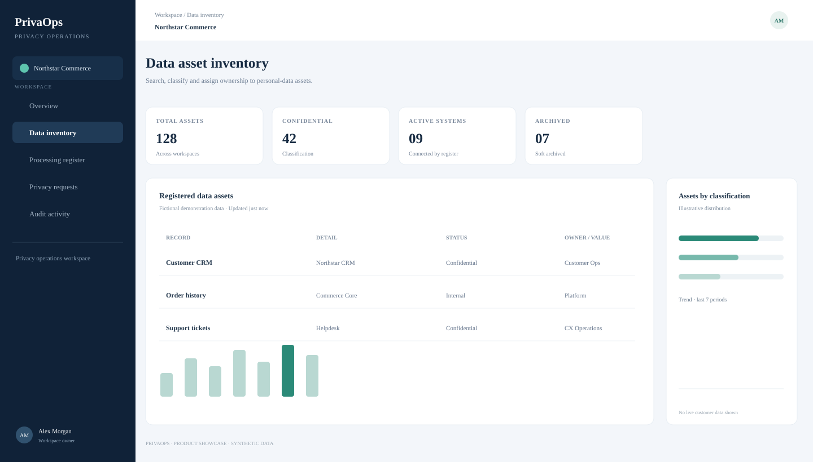

### 04 · Data asset profile
A focused record view showing the system, ownership, data-subject scope, and asset metadata.

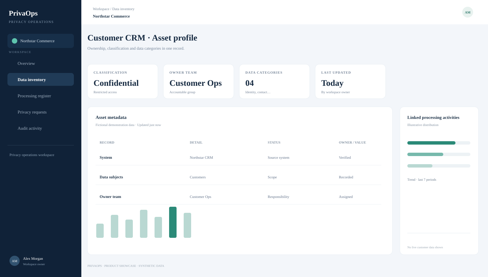

### 05 · Processing activities register
A structured register for processing purpose, operational legal-basis labels, linked assets, and retention context.

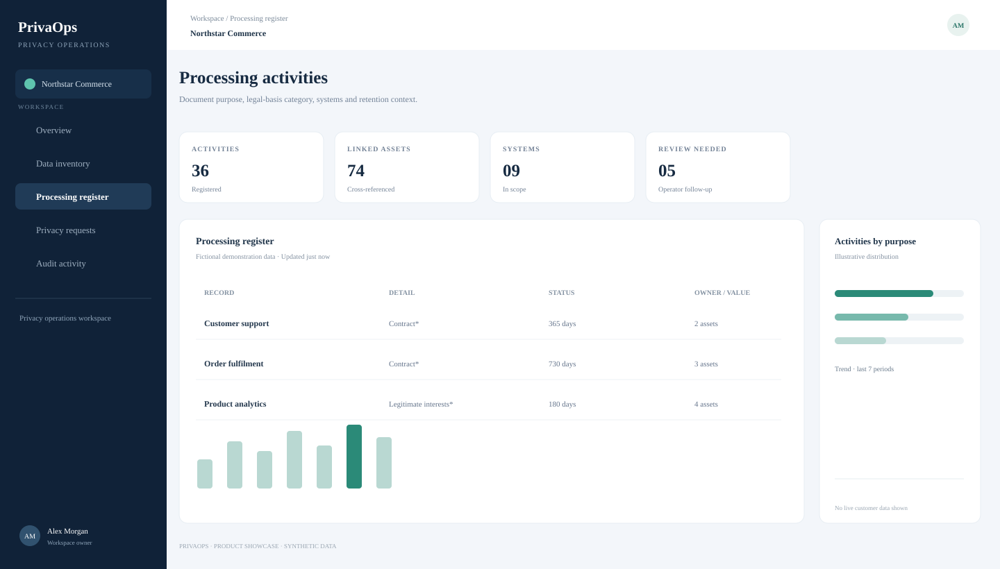

### 06 · Processing activity profile
A detailed operational view of purpose, data categories, data subjects, systems, and linked assets.

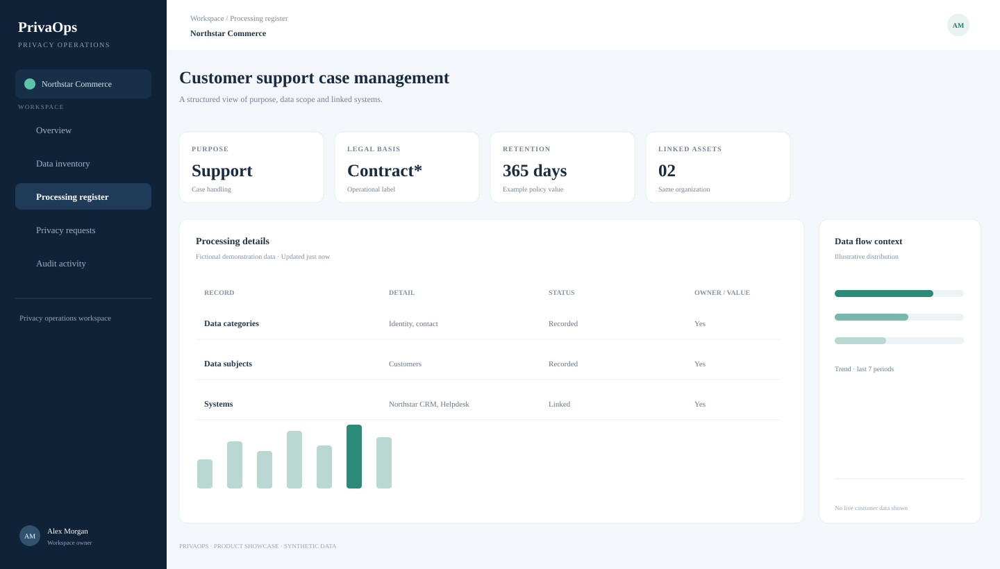

### 07 · Privacy request queue
A triage-oriented queue for request types, lifecycle states, and upcoming operational due dates.

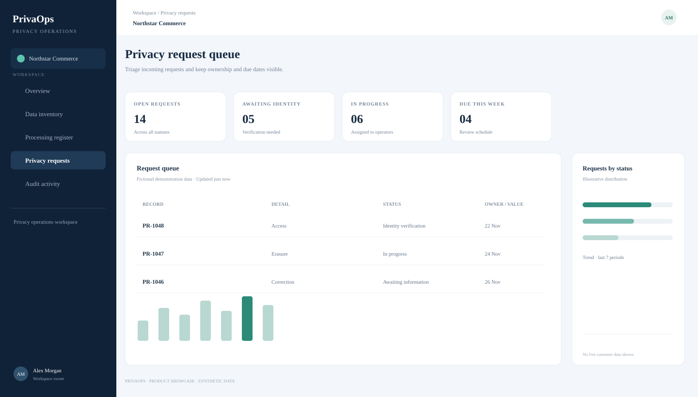

### 08 · Privacy request detail & timeline
A request-level view of assignment, identity verification, status progression, and event history.

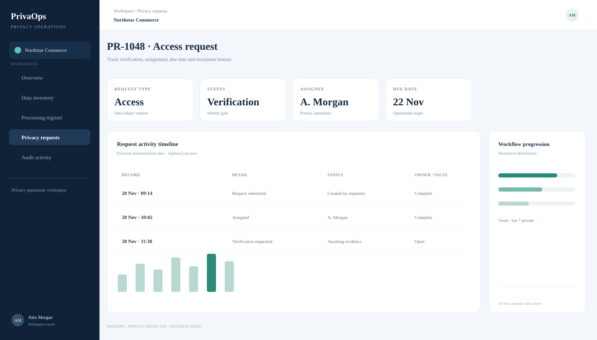

### 09 · Audit activity
An organization-scoped operational history showing who performed an action and which fields changed—without exposing before/after personal-data values.

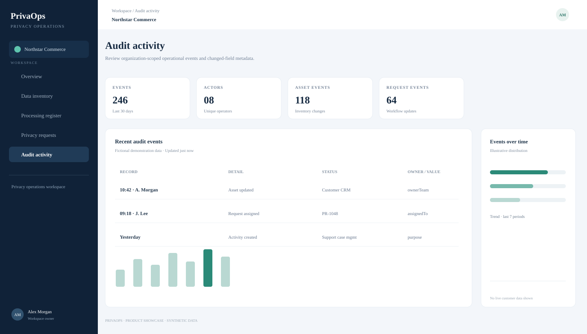

### 10 · Assignment & due-date operations
A workload view for making request ownership and operational deadlines visible.

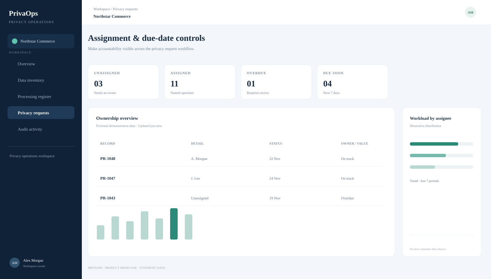

### 11 · Search & filter experience
A conceptual view of narrowing inventory records by keyword, classification, owner team, and status.

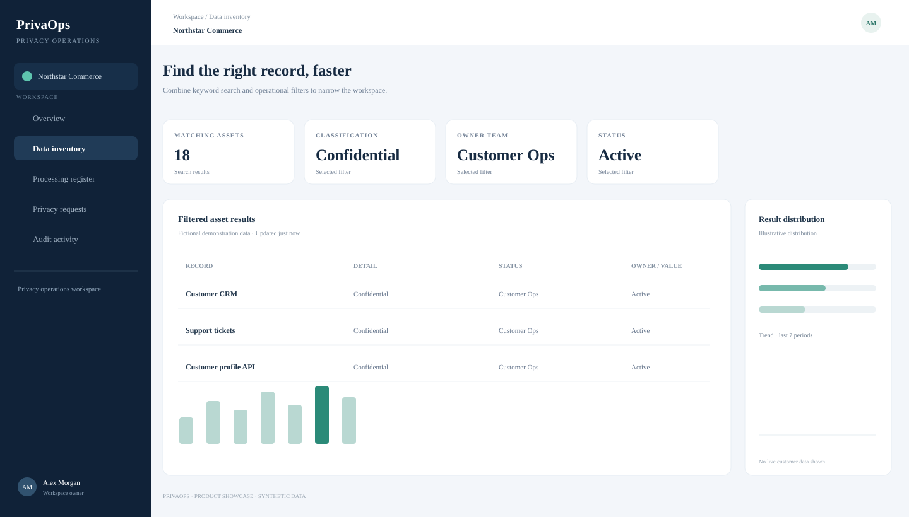

### 12 · Export & reporting
A view of the tenant-scoped registers available for CSV export and downstream review.

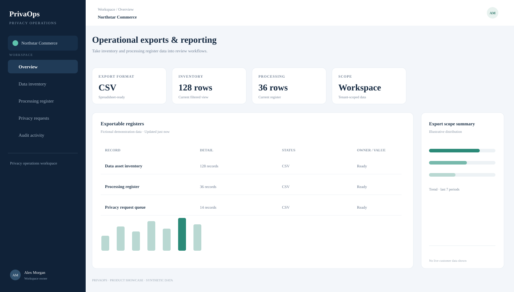

---

## 🔄 Key workflows

### Identity MFA API\n\n- `GET /api/v1/auth/mfa/status` — check whether TOTP MFA is enabled.\n- `POST /api/v1/auth/mfa/setup` — create a pending authenticator secret and provisioning URI.\n- `POST /api/v1/auth/mfa/confirm` — verify the first code and enable MFA.\n- `POST /api/v1/auth/mfa/disable` — require the current password and authenticator code; revoke refresh sessions.\n- `POST /api/v1/auth/mfa/verify-login` — complete a five-minute MFA challenge returned by password login.\n\nMFA secrets are encrypted at rest using a key derived from `ACCESS_TOKEN_SECRET`; rotating that secret requires users to re-enroll MFA. Store and rotate the signing secret securely. The login challenge is short-lived but currently not single-use; a production rollout should add persisted one-time challenge consumption and recovery codes.\n\n### 1. Map a data asset
1. An authorized workspace operator opens Data inventory.
2. They register a system, owner team, classification, data categories, and data-subject groups.
3. The API validates the payload and stores the asset under the authenticated organization.
4. Operators can search, filter, update, archive, and export the inventory.

### 2. Document a processing activity
1. The operator records the activity name and purpose.
2. They select an operational legal-basis category and document data categories and subjects.
3. They link same-organization assets and systems.
4. They record a retention period for operational reference.
5. The API validates tenant ownership of linked records.

### 3. Coordinate a privacy request
1. A requester submits a privacy request.
2. Authorized operators review the organization queue and request details.
3. The request can be assigned to an active organization member and given an operational due date.
4. Identity verification and explicit lifecycle transitions guide the workflow.
5. Fulfillment requires the workflow's verification and resolution conditions.
6. Request events provide a history of the operational steps.

### 4. Review operational activity
1. An owner/admin opens Audit activity.
2. They review the actor, action, resource, changed-field names, and timestamp.
3. The API scopes the query to the authenticated organization.
4. Audit metadata is designed to avoid storing before/after personal-data values.

---

## 🏗️ Architecture

```text
┌─────────────────────────────────────────────────────────────┐
│                     React 19 + Vite                         │
│   Overview · Inventory · Processing · Requests · Activity   │
└──────────────────────────────┬──────────────────────────────┘
                               │ HTTPS / JSON
                               ▼
┌─────────────────────────────────────────────────────────────┐
│                    Express 5 API                             │
│  Helmet · CORS · Zod · Rate limits · JWT · RBAC             │
│  /api/v1                                                     │
├─────────────────────────────────────────────────────────────┤
│ Identity & tenancy │ Inventory │ Processing │ Requests      │
│ Refresh sessions   │ Scope     │ Audit       │ Workflow      │
└──────────────────────────────┬──────────────────────────────┘
                               │ Mongoose
                               ▼
┌─────────────────────────────────────────────────────────────┐
│                         MongoDB                              │
│ Users · Organizations · Memberships · Sessions · Assets     │
│ Processing activities · Privacy requests · Audit events      │
└─────────────────────────────────────────────────────────────┘
```

### Repository structure

```text
.
├── apps/
│   ├── api/
│   │   └── src/
│   │       ├── modules/
│   │       │   ├── identity/          # Auth, sessions, RBAC, tenant scope
│   │       │   ├── inventory/         # Assets and processing register
│   │       │   └── privacy-requests/  # Request lifecycle and events
│   │       ├── app.ts
│   │       ├── env.ts
│   │       └── server.ts
│   └── web/
│       └── src/                       # React workspace and design system
├── packages/
│   └── shared/                        # Shared package boundary
├── docs/
│   ├── images/readme/                 # 12 illustrative dashboard previews
│   ├── ARCHITECTURE.md
│   ├── SECURITY.md
│   ├── DEMO_GUIDE.md
│   └── DEPLOYMENT_CHECKLIST.md
├── .github/workflows/ci.yml
├── docker-compose.yml
└── package.json
```

### Request and session lifecycle

- The browser stores the short-lived access token in JavaScript memory, not localStorage.
- The refresh token is opaque, stored as a hash in MongoDB, and sent to the browser in an HttpOnly cookie.
- Refresh rotation atomically consumes the old session before issuing a replacement.
- The frontend coordinates concurrent refresh attempts through a single in-flight promise.
- The API reloads the active user and membership and derives the role from the database.
- Organization IDs supplied in URLs are selectors only; they are never treated as authorization.

---

## 🛡️ Security design & honest limitations

### Implemented baseline controls

- **Password storage:** Argon2id password hashing.
- **Login timing:** unknown-account login attempts perform a dummy Argon2id verification to reduce account-enumeration timing differences.
- **Access tokens:** short-lived signed JWTs with issuer and audience validation.
- **Refresh sessions:** cryptographically random opaque tokens, SHA-256 hashes at rest, HttpOnly cookies, rotation, and logout revocation.
- **TOTP MFA:** encrypted authenticator secrets, enrollment confirmation, short-lived one-time login challenges, time-window verification, password-plus-code disable, and refresh-session revocation on disable.
- **Recovery codes:** ten random 128-bit codes per set, SHA-256 hashes at rest, atomic one-time consumption, and explicit rotation that invalidates the previous set.
- **Tenant isolation:** server-derived organization scope, active membership validation, organization-scoped database filters, and same-tenant reference validation.
- **Authorization:** explicit API permission matrix for owner, admin, member, and viewer roles.
- **Request validation:** Zod schemas and bounded JSON payloads.
- **Browser boundary:** Helmet, exact configured CORS origin, and trusted-origin checks on cookie-authenticated auth routes.
- **Abuse baseline:** authentication rate limiting.
- **Audit minimization:** changed-field names and operational metadata rather than before/after personal-data values.

### Residual risks before real personal data

- Email verification, password recovery, recovery codes, and invitation flows are not implemented. TOTP MFA is available through the API; a browser settings interface and recovery mechanism remain roadmap items.
- Refresh-session logout does not instantly revoke an already-issued access token; access tokens remain valid until expiry unless account/membership checks reject the request.
- Production cookie behavior depends on exact HTTPS origins and browser third-party-cookie policies. Same-site custom domains are preferred.
- The default in-memory rate limiter is not a distributed abuse-control strategy for multi-instance deployments.
- The audit collection is not independently immutable; database administrators can alter records.
- Privacy request descriptions may contain personal data; production retention, redaction, access review, and deletion policies must be defined.
- Production operations still need a threat review, security integration/E2E tests, dependency vulnerability remediation, backups, restore drills, monitoring, alerting, and incident response.

See [Security notes & threat model](docs/SECURITY.md) for the complete checklist.

---

## 🧰 Technology stack

| Layer | Technologies |
| --- | --- |
| Frontend | React 19, Vite 6, TypeScript |
| Styling | CSS design system, responsive layouts, system font stack |
| Backend | Node.js 22+, Express 5, TypeScript |
| Validation | Zod |
| Database | MongoDB, Mongoose |
| Authentication | Argon2id, jose/JWT, opaque refresh tokens, HttpOnly cookies |
| Security middleware | Helmet, CORS, express-rate-limit |
| Testing | Vitest |
| Code quality | ESLint, TypeScript |
| CI | GitHub Actions |
| Hosting handoff | Vercel (web), Render (API), MongoDB Atlas (database) — operator-managed |

---

## 🚀 Run locally

### Prerequisites

- Node.js **22 or newer**
- npm **10 or newer**
- MongoDB locally or an accessible MongoDB deployment
- Git

### 1. Clone the repository

```bash
git clone https://github.com/matiur25580/PrivaOps-Enterprise-Privacy-Data-Lifecycle-Platform.git
cd PrivaOps-Enterprise-Privacy-Data-Lifecycle-Platform
```

### 2. Configure API environment

```bash
cp .env.example .env
openssl rand -base64 48
```

Put the generated random value in `ACCESS_TOKEN_SECRET`. Never commit a real secret.

### 3. Start MongoDB

If using the included Docker Compose service:

```bash
docker compose up -d mongodb
```

### 4. Install dependencies

```bash
npm install
```

### 5. Configure the frontend API URL

Create or update `apps/web/.env`:

```dotenv
VITE_API_URL=http://localhost:4000/api/v1
```

### 6. Start both applications

```bash
npm run dev
```

Default local URLs:

| Service | URL |
| --- | --- |
| Web workspace | http://localhost:5173 |
| API | http://localhost:4000 |
| API base path | http://localhost:4000/api/v1 |
| Liveness | http://localhost:4000/health/live |
| Readiness | http://localhost:4000/health/ready |

---

## ⚙️ Environment variables

### API — root `.env`

| Variable | Required | Description |
| --- | --- | --- |
| `NODE_ENV` | No | `development`, `test`, or `production` |
| `API_PORT` | No | API port; defaults to platform `PORT` when present, otherwise `4000` |
| `WEB_ORIGIN` | No locally | Exact allowed browser origin for credentialed CORS and trusted-origin checks |
| `MONGODB_URI` | Yes for API | MongoDB connection string |
| `ACCESS_TOKEN_SECRET` | Yes | Random signing secret, minimum 32 characters |
| `ACCESS_TOKEN_TTL_SECONDS` | No | Access-token lifetime; default 900 seconds |
| `REFRESH_TOKEN_TTL_DAYS` | No | Refresh-session lifetime; default 7 days |

### Web — `apps/web/.env`

| Variable | Required | Description |
| --- | --- | --- |
| `VITE_API_URL` | Recommended | Public API base URL including `/api/v1` |

**Important:** Vite exposes `VITE_*` values to the browser bundle. Never place database URIs, token-signing secrets, private API keys, or other secrets in frontend environment variables.

---

## 🧪 Quality checks

Run these commands from the repository root:

```bash
npm run lint
npm run typecheck
npm run test
npm run build
```

GitHub Actions runs the install, lint, typecheck, unit-test, and build pipeline on pull requests and pushes to `main`.

---

## 🔌 API reference

All application routes are mounted below `/api/v1`.

### Identity

| Method | Endpoint | Purpose |
| --- | --- | --- |
| POST | `/auth/register` | Create a user, organization, owner membership, and session |
| POST | `/auth/login` | Authenticate; MFA-enabled accounts receive a second-factor challenge |
| POST | `/auth/mfa/verify-login` | Complete one-time MFA challenge using TOTP or recovery code |
| GET | `/auth/mfa/status` | Read MFA state and unused recovery-code count |
| POST | `/auth/mfa/setup` | Start authenticator enrollment |
| POST | `/auth/mfa/confirm` | Confirm and enable authenticator MFA |
| POST | `/auth/mfa/recovery-codes` | Rotate recovery codes after password and TOTP verification |
| POST | `/auth/mfa/disable` | Disable MFA and revoke refresh sessions after password and TOTP verification |
| POST | `/auth/refresh` | Rotate the refresh session |
| POST | `/auth/logout` | Revoke refresh session and clear cookie |
| GET | `/auth/me` | Read current authenticated identity |

### Organization context

| Method | Endpoint | Purpose |
| --- | --- | --- |
| GET | `/organizations/:id/context` | Read authenticated organization context |
| GET | `/organizations/:id/members` | Read active members where permitted |

### Data inventory & processing

| Method | Endpoint | Purpose |
| --- | --- | --- |
| GET / POST | `/organizations/:id/data-assets` | List or create assets |
| PATCH / DELETE | `/organizations/:id/data-assets/:assetId` | Update or soft-archive an asset |
| GET / POST | `/organizations/:id/processing-activities` | List or create processing activities |
| PATCH / DELETE | `/organizations/:id/processing-activities/:activityId` | Update or soft-archive an activity |
| GET | `/organizations/:id/audit-events` | Read inventory audit activity (owner/admin) |

### Privacy requests

| Method | Endpoint | Purpose |
| --- | --- | --- |
| GET / POST | `/organizations/:id/privacy-requests` | Read authorized queue or submit a request |
| GET | `/organizations/:id/privacy-requests/mine` | Read own requests |
| GET | `/organizations/:id/privacy-requests/:requestId/events` | Read request event history |
| PATCH | `/organizations/:id/privacy-requests/:requestId` | Update workflow (owner/admin) |
| POST | `/organizations/:id/privacy-requests/:requestId/withdraw` | Withdraw own request |

### Health

| Method | Endpoint | Purpose |
| --- | --- | --- |
| GET | `/health/live` | Process liveness |
| GET | `/health/ready` | MongoDB readiness (503 until connected) |
| GET | `/api/v1` | API name and version |

---

## 📚 Documentation

- [Architecture overview](docs/ARCHITECTURE.md) — components, request flow, tenant invariants, and audit semantics.
- [Security notes & threat model](docs/SECURITY.md) — implemented controls, residual risks, and pre-production checklist.
- [5-minute portfolio demo](docs/DEMO_GUIDE.md) — a guided walkthrough using a fictional organization.
- [Manual deployment runbook](docs/DEPLOYMENT_CHECKLIST.md) — Atlas, Render, Vercel, environment variables, smoke tests, rollback, and release sign-off.
- [Identity module notes](apps/api/src/modules/identity/README.md) — authentication, refresh sessions, and tenant security.

---

## ☁️ Manual deployment

Deployment is intentionally **operator-controlled**. No deployment is performed by this repository workflow.

Recommended topology:

- **Web:** Vercel, configured from the monorepo root.
- **API:** Render Web Service, configured from the monorepo root.
- **Database:** a dedicated MongoDB Atlas database and least-privilege database user.
- **Domains:** HTTPS web and API origins; same-site custom domains are preferred for reliable refresh-cookie behavior.

### Build settings

| Setting | Web (Vercel) | API (Render) |
| --- | --- | --- |
| Root directory | Repository root | Repository root |
| Runtime | Node.js 22.x | Node.js 22.x |
| Install | `npm install` | `npm install` |
| Build | `npm run build --workspace @privaops/web` | `npm run build --workspace @privaops/api` |
| Output / start | `apps/web/dist` | `npm run start --workspace @privaops/api` |
| Environment | `VITE_API_URL=https://<api-host>/api/v1` | `NODE_ENV`, `MONGODB_URI`, `ACCESS_TOKEN_SECRET`, `WEB_ORIGIN` |

For full provider configuration, cookie-origin guidance, health checks, smoke tests, hardening, rollback, and release sign-off, follow [docs/DEPLOYMENT_CHECKLIST.md](docs/DEPLOYMENT_CHECKLIST.md).

---

## ⚖️ Privacy & compliance note

PrivaOps helps teams organize operational privacy information. It does not determine whether a processing activity is lawful, provide legal advice, certify compliance with the DPDP Act, GDPR, or another privacy law, or automatically execute retention/deletion obligations. Organizations must validate their legal basis, notices, retention rules, request handling, and regulatory duties with qualified professionals.

Use synthetic data for demos and development. Do not enter real personal data into a portfolio deployment.

---

## 🎯 Portfolio & interview discussion

This project demonstrates practical engineering decisions worth discussing in a technical interview:

- Designing a multi-tenant domain model and enforcing tenant isolation in server-side queries.
- Building an explicit RBAC permission matrix instead of trusting frontend visibility.
- Implementing Argon2id password hashing and opaque refresh-token rotation.
- Reducing account-enumeration timing differences with dummy password verification.
- Modeling privacy request lifecycle transitions and verification gates.
- Capturing audit metadata while minimizing exposure of personal-data values.
- Handling concurrent browser refresh attempts and retrying an API request only once.
- Separating liveness from dependency readiness and documenting an operator-led release process.
- Communicating residual security risks honestly rather than overstating production readiness.

---

<div align="center">

**PrivaOps · Enterprise Privacy & Data Lifecycle Operations**

Built as a practical, security-conscious engineering portfolio project.

</div>
